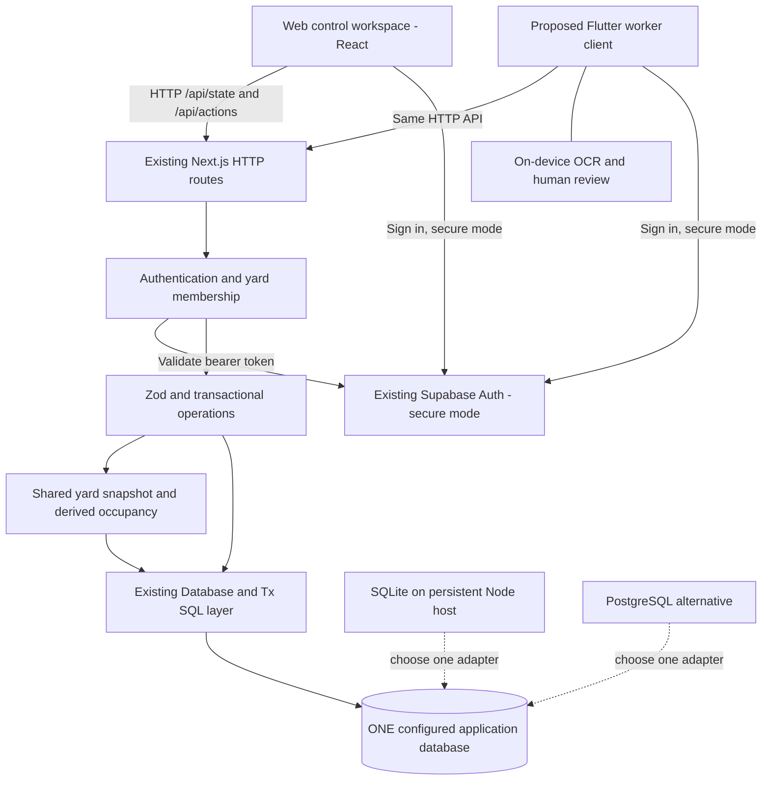
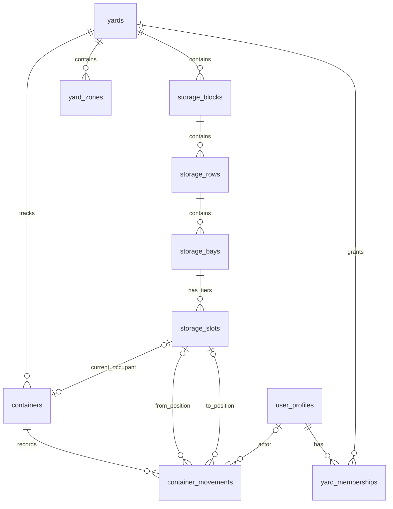
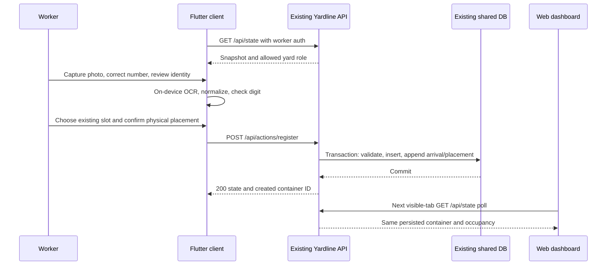

# Yardline mobile integration: existing backend audit

> **Flutter implementation:** The native worker client is implemented in the separate [Yardline App repository](https://github.com/bhavya03-03/Yardline-App); see its [README](https://github.com/bhavya03-03/Yardline-App#readme) for capabilities and verification. New-container registration and OCR belong to mobile; the web registration tab and shortcuts are removed, but the existing registration API and shared database remain available. The website refreshes shared state every 30 seconds while visible and when focus, visibility, or connectivity returns. Backend source paths below refer to the [website repository](https://github.com/bhavya03-03/Yardline/tree/master/yardline). This audit remains the backend reference; the native app adds no backend, database, schema, or API route.

Inspected on 2026-10-18 against commit `f3b3cc3` (`figmafinal`). This is a source-based description of the current system, with recommendations explicitly separated from existing functionality. The mobile client is intended to use Flutter/Dart. No application code, schema, API, deployment configuration, or production data was changed for this audit.

## Deployment addendum (2026-10-18)

After the source audit, the separately authorized Netlify deployment completed at **https://yardline-bhavya0303.netlify.app**. This section supersedes the original audit's deployment and PostgreSQL verification limits. One Netlify-managed PostgreSQL database serves the hosted web UI and all API clients. `netlify.toml`, `@netlify/database`, and `src/server/db.ts` configure managed provisioning, ordered SQL migrations, and the existing `pg` adapter through `NETLIFY_DB_URL`. Migration `002_initial_demo.sql` preserves the existing synthetic demo snapshot. The local SQLite database is unchanged and does not synchronize with the hosted instance.

Live verification confirmed PostgreSQL snapshots, all 102 containers and 212 movements, viewer write rejection, and rollback of an invalid relocation with unchanged container assignments/history. Supabase individual-worker sign-in and yard memberships remain unverified in a hosted environment. No server OCR, event stream, or new mobile endpoints were added.

The owner subsequently requested removal of the production sign-in requirement. The hosted demo uses `AUTH_MODE=demo` with the optional gate in `src/proxy.ts` disabled through production environment overrides: `YARDLINE_REQUIRE_ACCESS_GATE=false` and no production access credentials. Production clients send no Basic header and select/persist the operator cookie via `/api/session`. Anyone with the link can use the shared demo personas; no cookie defaults to administrator. See the deployment section in [MOBILE_API_CONTRACT.md](MOBILE_API_CONTRACT.md). Individual worker authentication remains a separate Supabase bearer-authentication setup. Netlify team login and existing gate settings remain enabled for non-production deployments.

Read alongside:

- [MOBILE_API_CONTRACT.md](MOBILE_API_CONTRACT.md): wire types, requests, responses, and client rules.
- [MOBILE_IMPLEMENTATION_GUIDE.md](MOBILE_IMPLEMENTATION_GUIDE.md): ordered Flutter implementation and demonstration steps.

## 1. Executive integration decision

**Use one running Yardline backend and its existing database for both clients.** A Flutter worker app can already read yard state, register containers, assign positions, relocate, dispatch, verify a recorded location, retrieve photographs, and inspect recent movement history through the existing HTTP API. It must not write to SQLite, PostgreSQL, or Supabase application tables directly.

For a shared hosted demonstration, use the verified Netlify deployment described above. A local alternative uses the existing Node server and SQLite file on the control-system laptop, reached over a trusted LAN by the phone. Individually authenticated remote operation still requires configured worker authentication. PostgreSQL is optional for a persistent single-server deployment, but necessary instead of local SQLite for an ephemeral/serverless deployment.

Important limits:

- Authentication defaults to an explicitly insecure, switchable demo identity; a missing demo cookie grants the administrator demo role.
- PostgreSQL persistence is now verified on Netlify. Supabase token verification and individual yard memberships remain **UNVERIFIED** in a live deployment.
- Dashboard synchronization is periodic HTTP polling, not a realtime event stream.
- OCR is currently browser-side Tesseract.js. There is no server OCR endpoint.
- OCR confidence, recognized-versus-corrected text, device timestamps, and idempotency keys have no structured persistence contract.
- Search, available-position browsing, and history are supplied through a yard snapshot, not dedicated paginated endpoints.
- Gate-in for a new container is registration. Re-entry of a dispatched container number is not supported.

## 2. Evidence and verification boundaries

| Evidence                     | Location                                                                  | What it establishes                                                         |
| ---------------------------- | ------------------------------------------------------------------------- | --------------------------------------------------------------------------- |
| Dependencies and commands    | `package.json`, `package-lock.json`                                       | Next.js, React, TypeScript, Zod, pg, Supabase JS, Tesseract.js              |
| All HTTP routes              | `src/app/api/**/route.ts`                                                 | Four route files; nine mutation actions                                     |
| Input validation             | `src/server/validation.ts`                                                | Actual request fields, defaults, limits, validation errors                  |
| Authentication/authorization | `src/server/auth.ts`                                                      | Demo cookie, Supabase bearer verification, membership checks, origin checks |
| Business rules               | `src/server/operations.ts`                                                | Role enforcement, ISO validation, occupancy/stack rules, event recording    |
| Database adapters            | `src/server/db.ts`                                                        | SQL access, transactions, locks, setup, PostgreSQL RLS/revocations          |
| Physical schema              | `migrations/001_schema.sql`                                               | Ten tables, foreign keys, checks, unique constraints, indexes               |
| Read model                   | `src/server/service.ts`                                                   | Snapshot joins, accessible yards, metrics, 1,000-event ceiling              |
| Wire models/helpers          | `src/lib/types.ts`, `identity.ts`, `placement.ts`, `client-api.ts`        | Response interfaces, check digits, placement hints, bearer requests         |
| Existing clients             | `src/components/yardline-app.tsx`, `workflows.tsx`, `yard-map.tsx`        | Polling, sign-in, OCR, registration, moves, binary photo retrieval          |
| Administration               | `scripts/provision.ts`, `database.ts`, `env.ts`, `src/server/seed.ts`     | Worker provisioning, schema setup, seed/reset constraints                   |
| Deployment                   | `next.config.ts`, `.env.example`, `README.md`                             | Node hosting requirements; no provider deployment manifest                  |
| Tests                        | `tests/backend.test.ts`, `tests/e2e/yard.spec.ts`, `playwright.config.ts` | Isolated database tests and existing browser/API scenarios                  |

For this audit, `npm.cmd test` ran successfully: **25 tests passed**, using fresh in-memory SQLite databases. This verifies the tested operation layer, not a live phone, a public deployment, Supabase, PostgreSQL, or cross-process database concurrency. Existing Playwright tests were inspected; the browser suite was not rerun for this documentation-only task. No requests were issued against the presentation database.

## 3. Existing architecture

### 3.1 Technologies and connection architecture

| Area               | Existing implementation                                                                         |
| ------------------ | ----------------------------------------------------------------------------------------------- |
| Backend            | Next.js App Router route handlers, TypeScript, Node runtime; package declares Next `^16.2.0`    |
| Administrative UI  | React `^19.2.4`, TypeScript, Tailwind CSS 4 plus CSS; single `/` workspace route                |
| Default database   | Node `node:sqlite` `DatabaseSync`; `./data/yardline.sqlite` unless `DATABASE_PATH` is set       |
| Optional database  | PostgreSQL via `pg.Pool`, `PERSISTENCE=postgres`, server-only `DATABASE_URL`, pool max 5        |
| Access layer       | Custom `Database`/`Tx` wrapper, parameterized raw SQL; **no ORM**                               |
| Schema management  | Repeatable initial SQL file, applied in `Database.setup()`; no versioned migration ledger       |
| Request validation | Zod 4 objects plus operation-level business checks                                              |
| Secure identity    | Supabase Auth `getUser(accessToken)` on the server; password sign-in currently in web client    |
| Local identity     | `yardline_role` demo cookie; no actual login/worker proof                                       |
| Realtime           | None. Visible web tabs poll `GET /api/state` every 30 seconds                                   |
| OCR                | Tesseract.js 7 in the browser, locally served worker/WASM/English model assets                  |
| Photos             | Optional base64 data URL stored in `containers.photo`, retrieved by protected binary HTTP route |
| API style          | JSON snapshot plus action RPC endpoints, not conventional per-resource REST CRUD                |

The database instance is reused through `globalThis.__yardlineDb`. All work passes through a process-local promise queue. SQLite enables foreign keys, WAL, and a 5,000 ms busy timeout and starts `BEGIN IMMEDIATE` transactions. PostgreSQL starts a transaction and obtains `pg_advisory_xact_lock(927154)` before running application work. Reads also use this transaction wrapper. PostgreSQL serialization spans cooperating application processes sharing the same database and advisory lock; it is not proof against arbitrary external SQL writers.

Node **24.12 or newer** is documented as required; the audit machine runs Node 24.19.0. `node:sqlite` is imported at module load even when PostgreSQL is selected. Do not assume an older Node runtime can host PostgreSQL mode.

### 3.2 Architecture diagram



Both clients must use the same API deployment. There is no client-to-client replication. Supabase Auth supplies identity; the existing Yardline service owns yard operations and application data. Choosing PostgreSQL is an alternative server configuration, not permission to build a second mobile database/backend.

### 3.3 Hosting and environment

- `npm run dev` and `npm start` bind Next to `0.0.0.0`, default port 3000. Production build is `npm run build`.
- `next.config.ts` selects `.next` or `NEXT_DIST_DIR`, externalizes `pg`, and disables the powered-by header. `allowedDevOrigins: ['127.0.0.1']` is a Next development setting, **not API CORS configuration**.
- At the original audit baseline, no deployment manifest was present. The later deployment adds `netlify.toml` and is verified as described in the addendum.
- SQLite requires persistent writable disk. Never put its file on ephemeral functions or run independent copies per service instance.
- `migrations/001_schema.sql` is read at runtime using `resolve(...)`; the deployed working directory/bundle must include it.
- OCR files in `public/ocr/` are generated during install/predev/prebuild by `scripts/prepare-ocr.mjs`.
- Server-only settings: `PERSISTENCE`, `DATABASE_PATH` or `DATABASE_URL`, `AUTH_MODE`, `DEMO_SEED`. Mobile needs none of the database settings.
- Mobile public configuration: API origin; Supabase project URL and public anon/publishable key **only if secure auth is enabled**. These must point to the same identity project the backend uses.

## 4. Complete existing database schema

Source of truth: `migrations/001_schema.sql`. All ten tables below **EXIST**. SQL types are exactly the portable declarations: `TEXT`, `REAL`, `INTEGER`. PostgreSQL `REAL` is not a geographic precision model. IDs are stored as text; operation-generated IDs use `randomUUID()`, but demo user IDs such as `demo-operator` are not UUIDs. Treat all IDs as opaque strings.

Conventions: `PK` primary key, `FK` foreign key, `NN` NOT NULL, `UQ` unique. Columns are nullable only where explicitly stated. All timestamps are TEXT; application writes ISO 8601 UTC strings, not database timestamp types. No FK has an explicit cascading delete/update policy. No operational delete API exists.

### 4.1 `yards`

| Field        | SQL type | Constraints/default                                         |
| ------------ | -------- | ----------------------------------------------------------- |
| `id`         | TEXT     | PK                                                          |
| `code`       | TEXT     | NN, UQ                                                      |
| `name`       | TEXT     | NN                                                          |
| `width`      | REAL     | NN, `> 0`                                                   |
| `height`     | REAL     | NN, `> 0`                                                   |
| `boundary`   | TEXT     | NN, default `'[]'`; JSON string of ordered `[x,y]` points   |
| `is_demo`    | INTEGER  | NN, default `0`; application 0/1 flag, no SQL boolean check |
| `created_at` | TEXT     | NN                                                          |

`code` is globally unique and immutable through the API. Layout coordinates are local plot units, presented as meters; no latitude/longitude or GPS-to-slot mapping exists.

### 4.2 `storage_blocks`

| Field                       | SQL type  | Constraints/default                 |
| --------------------------- | --------- | ----------------------------------- |
| `id`                        | TEXT      | PK                                  |
| `yard_id`                   | TEXT      | NN, FK `yards.id`                   |
| `code`                      | TEXT      | NN                                  |
| `name`                      | TEXT      | NN                                  |
| `x`, `y`, `width`, `height` | REAL each | NN; geometry checked by application |
| `max_tiers`                 | INTEGER   | NN, between 1 and 6                 |
| `capacity_limit`            | INTEGER   | NN, `> 0`                           |
| `max_size`                  | INTEGER   | NN, default 40, one of 20/40/45     |

UQ `(yard_id,code)`. Index `idx_blocks_yard(yard_id)`. Block code is immutable through existing operations. Capacity may be lower than generated slot count.

### 4.3 `storage_rows`

| Field      | SQL type | Constraints                |
| ---------- | -------- | -------------------------- |
| `id`       | TEXT     | PK                         |
| `block_id` | TEXT     | NN, FK `storage_blocks.id` |
| `code`     | TEXT     | NN                         |
| `ordinal`  | INTEGER  | NN, `> 0`                  |

UQ `(block_id,code)`, UQ `(block_id,ordinal)`. Index `idx_rows_block(block_id)`.

### 4.4 `storage_bays`

| Field       | SQL type | Constraints              |
| ----------- | -------- | ------------------------ |
| `id`        | TEXT     | PK                       |
| `row_id`    | TEXT     | NN, FK `storage_rows.id` |
| `code`      | TEXT     | NN                       |
| `ordinal`   | INTEGER  | NN, `> 0`                |
| `max_tiers` | INTEGER  | NN, between 1 and 6      |

UQ `(row_id,code)`, UQ `(row_id,ordinal)`. Index `idx_bays_row(row_id)`.

### 4.5 `storage_slots` (storage positions and tiers)

| Field      | SQL type  | Constraints/default                                                   |
| ---------- | --------- | --------------------------------------------------------------------- |
| `id`       | TEXT      | PK                                                                    |
| `bay_id`   | TEXT      | NN, FK `storage_bays.id`                                              |
| `tier`     | INTEGER   | NN, between 1 and 6                                                   |
| `code`     | TEXT      | NN, globally UQ                                                       |
| `x`, `y`   | REAL each | NN                                                                    |
| `status`   | TEXT      | NN, default `available`; enum `available/reserved/blocked/restricted` |
| `max_size` | INTEGER   | NN, default 40, enum 20/40/45                                         |
| `capacity` | INTEGER   | NN, default 1, CHECK `capacity = 1`                                   |

UQ `(bay_id,tier)`. Index `idx_slots_bay(bay_id)`. A tier is a slot attribute, **not a separate table**. Example display code: `YD01-B01-R01-BY01-T01`. Assignment APIs require the slot `id`, not this code.

`slot.status = 'available'` describes administrative eligibility, **not occupancy**. An occupied slot normally still has status `available`. Occupancy must be derived from containers.

### 4.6 `containers`

| Field               | SQL type | Constraints/default                                      |
| ------------------- | -------- | -------------------------------------------------------- |
| `id`                | TEXT     | PK                                                       |
| `number`            | TEXT     | NN, globally UQ; normalized by API                       |
| `size`              | INTEGER  | NN, enum 20/40/45, feet                                  |
| `type`              | TEXT     | NN, default `Dry`; application length bound, no SQL enum |
| `owner`             | TEXT     | NN, default empty string                                 |
| `status`            | TEXT     | NN, enum `stored/unassigned/dispatched`                  |
| `current_yard_id`   | TEXT     | NN, FK `yards.id`                                        |
| `current_slot_id`   | TEXT     | Nullable, UQ, FK `storage_slots.id`                      |
| `identity_verified` | INTEGER  | NN, default 1; application 0/1 flag                      |
| `registered_at`     | TEXT     | NN                                                       |
| `verified_at`       | TEXT     | Nullable                                                 |
| `notes`             | TEXT     | NN, default empty string                                 |
| `photo`             | TEXT     | Nullable; JPEG/PNG/WebP base64 data URL                  |

CHECK: stored containers must have a slot; all other statuses must have a null slot. Index `idx_containers_yard(current_yard_id)`. Global number uniqueness also applies to dispatched containers and other yards. The DB does not itself normalize/check ISO numbers or ensure a slot belongs to `current_yard_id`; the service does.

The snapshot excludes `photo` and adds joined `location_code` plus integer `has_photo`. `identity_verified` records number validity, not a separately persisted human-review checkbox. `verified_at` records confirmed location time; location verification does not repair an invalid identity.

### 4.7 `user_profiles`

| Field          | SQL type | Constraints                                 |
| -------------- | -------- | ------------------------------------------- |
| `id`           | TEXT     | PK; secure-mode Supabase user ID or demo ID |
| `display_name` | TEXT     | NN                                          |

No password, refresh token, email, job title, or worker-specific table. Supabase Auth's external user directory is not defined in this schema. There is no FK to `auth.users`. Authenticated subjects must be provisioned through the existing process.

### 4.8 `yard_memberships`

| Field     | SQL type | Constraints                              |
| --------- | -------- | ---------------------------------------- |
| `user_id` | TEXT     | NN, FK `user_profiles.id`, composite PK  |
| `yard_id` | TEXT     | NN, FK `yards.id`, composite PK          |
| `role`    | TEXT     | NN, enum `administrator/operator/viewer` |

PK `(user_id,yard_id)`. Index `idx_memberships_yard(yard_id)`. Role is per yard; Flutter must reevaluate permissions when switching yards.

### 4.9 `container_movements`

| Field          | SQL type | Constraints/default                                           |
| -------------- | -------- | ------------------------------------------------------------- |
| `id`           | TEXT     | PK                                                            |
| `container_id` | TEXT     | NN, FK `containers.id`                                        |
| `from_slot_id` | TEXT     | Nullable, FK `storage_slots.id`                               |
| `to_slot_id`   | TEXT     | Nullable, FK `storage_slots.id`                               |
| `event_type`   | TEXT     | NN, enum `arrival/placement/relocation/dispatch/verification` |
| `occurred_at`  | TEXT     | NN; server-assigned                                           |
| `user_id`      | TEXT     | Nullable, FK `user_profiles.id`; service records actor ID     |
| `actor_name`   | TEXT     | NN; service records authenticated subject name                |
| `notes`        | TEXT     | NN, default empty string                                      |

Indexes `idx_movements_container(container_id,occurred_at)` and `idx_movements_time(occurred_at)`. No operation deletes history. There are no immutable audit triggers, version columns, client-operation IDs, or database checks matching event type to from/to slots. The seed can update demo actor names; this is not a tamper-proof audit ledger.

### 4.10 `yard_zones`

| Field             | SQL type  | Constraints                        |
| ----------------- | --------- | ---------------------------------- |
| `id`              | TEXT      | PK                                 |
| `yard_id`         | TEXT      | NN, FK `yards.id`                  |
| `kind`            | TEXT      | NN, enum `road/loading/restricted` |
| `label`           | TEXT      | NN                                 |
| `x`, `y`          | REAL each | NN                                 |
| `width`, `height` | REAL each | NN, `> 0`                          |

Index `idx_zones_yard(yard_id)`. Zones are non-storage geometry, not assignable positions.

### 4.11 Relationships and occupancy



**No occupancy table exists or is needed.** `containers.current_slot_id` is the one mutable location record, protected by a unique constraint. Join it to slots to render occupancy. Do not add another mobile occupancy flag or authoritative mobile cache.

### 4.12 Recommended additions: NOT existing

These are backend-owner follow-up proposals, not migrations made by this task:

| Proposal                                                                                                                     | Reason                                                                                         | Needed for first demo?                                      |
| ---------------------------------------------------------------------------------------------------------------------------- | ---------------------------------------------------------------------------------------------- | ----------------------------------------------------------- |
| Idempotency record keyed by authenticated subject, yard, operation ID; request hash and committed outcome                    | Safely recover writes after network interruption and deduplicate verification events           | No, if writes remain online-only with manual reconciliation |
| Optional OCR provenance attached to registration: raw candidate, corrected number, engine/confidence semantics, capture time | Structured scan audit; confidence currently display-only                                       | No                                                          |
| Separate client-observed and server-recorded timestamps                                                                      | Offline chronology without trusting client clocks as authoritative                             | No                                                          |
| Transactional outbox/event cursor                                                                                            | Reliable push invalidations and durable reconnect                                              | No, polling works                                           |
| Container revision/version                                                                                                   | Detect change-away-and-back and duplicate concurrent verification, beyond slot-only comparison | No                                                          |
| Paginated history/search endpoint and controlled re-entry workflow                                                           | Larger datasets, complete histories, returning dispatched containers                           | Only if demonstration requires those cases                  |

All additions belong to the **existing** backend/database. A local mobile draft cache would be a non-authoritative convenience, not a second yard database.

## 5. Actual HTTP API

### 5.1 Routing, authentication, and common responses

The four route files expose:

| Method | Full path                              | Purpose                                       | Role                                     |
| ------ | -------------------------------------- | --------------------------------------------- | ---------------------------------------- |
| GET    | `/api/state?yard=<yard-id>`            | Accessible yards and selected yard snapshot   | Any member in secure mode; any demo role |
| POST   | `/api/actions/register`                | New arrival, optionally initial placement     | Administrator/operator                   |
| POST   | `/api/actions/move`                    | Place unassigned or relocate stored container | Administrator/operator                   |
| POST   | `/api/actions/dispatch`                | Gate-out and release slot                     | Administrator/operator                   |
| POST   | `/api/actions/verify`                  | Confirm current physical location             | Administrator/operator                   |
| GET    | `/api/containers/<container-id>/photo` | Attached image bytes                          | Member of container's yard               |
| POST   | `/api/session`                         | Select insecure demo role; not a secure login | Demo mode only                           |
| POST   | `/api/actions/create-yard`             | Create plot                                   | Administrator                            |
| POST   | `/api/actions/update-yard`             | Edit plot name/dimensions/boundary            | Administrator                            |
| POST   | `/api/actions/generate-block`          | Persist block/row/bay/tier layout             | Administrator                            |
| POST   | `/api/actions/create-zone`             | Create non-storage rectangle                  | Administrator                            |
| POST   | `/api/actions/update-slot`             | Change empty-slot status                      | Administrator                            |

All secure-mode requests above except the disabled demo-session endpoint use `Authorization: Bearer <ACCESS_TOKEN>`. Demo requests use the role cookie or default administrator. All action requests need `yardId` except `create-yard`. No API version prefix exists. IDs are opaque strings, normally 1-100 characters in mutation input. JSON responses use snake_case model fields; requests use the camelCase fields documented below.

All successful actions return **200**, including creation. Common response schemas are in section 5.3; full TypeScript response models are in `MOBILE_API_CONTRACT.md`. The POST schemas below describe the recommended JSON wire representation. Zod also coerces the documented numeric fields and strips unknown object keys; JSON Schema `default` annotations describe server defaults rather than a validator inserting them. Do not rely on numeric coercion or send undocumented fields.

An unknown action name returns 404 `NOT_FOUND` after authentication, initialization, and JSON parsing. Unsupported methods are handled by Next (normally 405) and need not use the application JSON error envelope. No custom CORS/OPTIONS implementation exists; automatic OPTIONS is not a CORS policy.

### 5.2 Read snapshot, search, positions, and history

**GET `/api/state`**, optional query **`yard`** containing the selected yard ID, not yard code. No body. Returns a bare `Snapshot`, not `{state: ...}`. Cache header: `Cache-Control: no-store`.

```http
GET /api/state?yard=<YARD_ID>
Authorization: Bearer <ACCESS_TOKEN>
Accept: application/json
```

Response shape:

```text
200 application/json
Snapshot = {
  yards, yard, blocks, rows, bays, slots, zones,
  containers, movements, metrics, actor,
  persistence, authMode, generatedAt
}
```

Every array/object is defined in the companion contract. Example **projection** of a snapshot (other required fields omitted for readability, not an alternative response shape):

```json
{
  "yard": {
    "id": "<YARD_ID>",
    "code": "YD01",
    "name": "North Yard",
    "width": 240,
    "height": 180,
    "boundary": "[]",
    "is_demo": 1,
    "created_at": "2026-10-18T08:00:00.000Z"
  },
  "actor": { "id": "demo-operator", "name": "Priya Patel", "role": "operator" },
  "persistence": "sqlite",
  "authMode": "demo",
  "generatedAt": "2026-10-18T09:00:00.000Z"
}
```

Errors: 401 `UNAUTHENTICATED` in secure mode; 403 `FORBIDDEN`/`NO_YARD`; 503 configuration/database failures. Initial secure-mode access with no membership cannot bootstrap a yard via the UI/API; use administrative provisioning.

Existing equivalents for common mobile reads:

| Requested capability      | Existing supported method                                            | Dedicated endpoint                                                        |
| ------------------------- | -------------------------------------------------------------------- | ------------------------------------------------------------------------- |
| Container search/detail   | Fetch state for yard, filter `containers` by normalized number or ID | **MISSING**: `GET /api/containers?search=...`, `GET /api/containers/<id>` |
| Yard list/layout          | `yards`, `yard`, `blocks`, `rows`, `bays`, `slots`, `zones` in state | **MISSING**: separate `/api/yards` resource API                           |
| Empty/available positions | Derive from slots plus current occupants; apply placement hints      | **MISSING**: `/api/positions/available`                                   |
| Movement history          | Filter `state.movements` by `container_id`, event type, dates        | **MISSING**: separate history or pagination route                         |
| Gate-in                   | `POST /api/actions/register` for a new number                        | **MISSING**: explicit gate-in/re-entry endpoint                           |
| Gate-out                  | `POST /api/actions/dispatch`                                         | **MISSING**: separate `/gate-out` route; not needed                       |

Search currently filters loaded data in the web client. A snapshot includes **only the selected yard's containers**, including dispatched entries. Do not assume an unsuccessful local search means the globally unique number is absent in other yards. Movement history is latest 1,000 events per selected yard, ordered by `occurred_at DESC, id DESC`; older data stays in the DB but has no paging API. Initial registration's arrival and placement share a timestamp, so do not infer event chronology from array position for ties.

Placement hints must exclude occupied, reserved, blocked, and restricted positions, enforce max length and lower-tier support/length matching, reject the current slot, and respect block capacity. `src/lib/placement.ts` is the existing client hint implementation. When moving within a full block, exclude the moving container when computing destination occupancy. Reject a move if containers are above its source. Final destination validation always runs again on the server.

Metrics are not a reservation system. `assignable` checks empty/eligible positions and lower-tier occupancy, but does not incorporate every size/capacity constraint. `available` is `max(0, usable - occupied)`; `usable` sums each block's minimum of capacity limit and administratively available slot count. `capacity` sums block limits. `utilization` is rounded percent of usable capacity. `attention` counts stored records whose location is older than 24 hours or whose identity is invalid. `movesToday` counts non-arrival/non-verification events from the already-limited history array using UTC day. It may undercount a busy yard.

### 5.3 Shared JSON response schemas

The following self-contained JSON Schema (draft 2020-12) describes the JSON response models. It is derived from `src/lib/types.ts` and the HTTP envelopes; the server does not publish or run this schema. Select `#/$defs/Snapshot` for GET state, `#/$defs/ActionResult` for all successful actions, `#/$defs/ApiError` for application failures, and `#/$defs/DemoSessionResult` for demo session success. Photo success is binary and outside this JSON schema. The TypeScript equivalents are in `MOBILE_API_CONTRACT.md`. Additional properties remain allowed for forward compatibility.

```json
{
  "$schema": "https://json-schema.org/draft/2020-12/schema",
  "title": "Existing Yardline JSON response shapes",
  "oneOf": [
    { "$ref": "#/$defs/Snapshot" },
    { "$ref": "#/$defs/ActionResult" },
    { "$ref": "#/$defs/ApiError" },
    { "$ref": "#/$defs/DemoSessionResult" }
  ],
  "$defs": {
    "Role": {
      "enum": ["administrator", "operator", "viewer"]
    },
    "SlotStatus": {
      "enum": ["available", "reserved", "blocked", "restricted"]
    },
    "ContainerStatus": {
      "enum": ["stored", "unassigned", "dispatched"]
    },
    "EventType": {
      "enum": ["arrival", "placement", "relocation", "dispatch", "verification"]
    },
    "Yard": {
      "type": "object",
      "required": ["id", "code", "name", "width", "height", "boundary", "is_demo", "created_at"],
      "properties": {
        "id": { "type": "string" },
        "code": { "type": "string" },
        "name": { "type": "string" },
        "width": { "type": "number" },
        "height": { "type": "number" },
        "boundary": { "type": "string" },
        "is_demo": { "type": "number" },
        "created_at": { "type": "string" }
      }
    },
    "Block": {
      "type": "object",
      "required": [
        "id",
        "yard_id",
        "code",
        "name",
        "x",
        "y",
        "width",
        "height",
        "max_tiers",
        "capacity_limit",
        "max_size"
      ],
      "properties": {
        "id": { "type": "string" },
        "yard_id": { "type": "string" },
        "code": { "type": "string" },
        "name": { "type": "string" },
        "x": { "type": "number" },
        "y": { "type": "number" },
        "width": { "type": "number" },
        "height": { "type": "number" },
        "max_tiers": { "type": "number" },
        "capacity_limit": { "type": "number" },
        "max_size": { "type": "number" }
      }
    },
    "StorageRow": {
      "type": "object",
      "required": ["id", "block_id", "code", "ordinal"],
      "properties": {
        "id": { "type": "string" },
        "block_id": { "type": "string" },
        "code": { "type": "string" },
        "ordinal": { "type": "number" }
      }
    },
    "Bay": {
      "type": "object",
      "required": ["id", "row_id", "code", "ordinal", "max_tiers"],
      "properties": {
        "id": { "type": "string" },
        "row_id": { "type": "string" },
        "code": { "type": "string" },
        "ordinal": { "type": "number" },
        "max_tiers": { "type": "number" }
      }
    },
    "Slot": {
      "type": "object",
      "required": [
        "id",
        "bay_id",
        "tier",
        "code",
        "x",
        "y",
        "status",
        "max_size",
        "capacity",
        "yard_id",
        "block_id",
        "row_id",
        "block_code",
        "row_code",
        "bay_code",
        "row_ordinal",
        "bay_ordinal"
      ],
      "properties": {
        "id": { "type": "string" },
        "bay_id": { "type": "string" },
        "tier": { "type": "number" },
        "code": { "type": "string" },
        "x": { "type": "number" },
        "y": { "type": "number" },
        "status": { "$ref": "#/$defs/SlotStatus" },
        "max_size": { "type": "number" },
        "capacity": { "type": "number" },
        "yard_id": { "type": "string" },
        "block_id": { "type": "string" },
        "row_id": { "type": "string" },
        "block_code": { "type": "string" },
        "row_code": { "type": "string" },
        "bay_code": { "type": "string" },
        "row_ordinal": { "type": "number" },
        "bay_ordinal": { "type": "number" }
      }
    },
    "Container": {
      "type": "object",
      "required": [
        "id",
        "number",
        "size",
        "type",
        "owner",
        "status",
        "current_yard_id",
        "current_slot_id",
        "identity_verified",
        "registered_at",
        "verified_at",
        "notes"
      ],
      "properties": {
        "id": { "type": "string" },
        "number": { "type": "string" },
        "size": { "type": "number" },
        "type": { "type": "string" },
        "owner": { "type": "string" },
        "status": { "$ref": "#/$defs/ContainerStatus" },
        "current_yard_id": { "type": "string" },
        "current_slot_id": {
          "anyOf": [{ "type": "string" }, { "type": "null" }]
        },
        "identity_verified": { "type": "number" },
        "registered_at": { "type": "string" },
        "verified_at": {
          "anyOf": [{ "type": "string" }, { "type": "null" }]
        },
        "notes": { "type": "string" },
        "has_photo": { "type": "number" },
        "location_code": {
          "anyOf": [{ "type": "string" }, { "type": "null" }]
        }
      }
    },
    "Movement": {
      "type": "object",
      "required": [
        "id",
        "container_id",
        "from_slot_id",
        "to_slot_id",
        "event_type",
        "occurred_at",
        "user_id",
        "actor_name",
        "notes",
        "container_number",
        "from_code",
        "to_code"
      ],
      "properties": {
        "id": { "type": "string" },
        "container_id": { "type": "string" },
        "from_slot_id": {
          "anyOf": [{ "type": "string" }, { "type": "null" }]
        },
        "to_slot_id": {
          "anyOf": [{ "type": "string" }, { "type": "null" }]
        },
        "event_type": { "$ref": "#/$defs/EventType" },
        "occurred_at": { "type": "string" },
        "user_id": {
          "anyOf": [{ "type": "string" }, { "type": "null" }]
        },
        "actor_name": { "type": "string" },
        "notes": { "type": "string" },
        "container_number": { "type": "string" },
        "from_code": {
          "anyOf": [{ "type": "string" }, { "type": "null" }]
        },
        "to_code": {
          "anyOf": [{ "type": "string" }, { "type": "null" }]
        }
      }
    },
    "Zone": {
      "type": "object",
      "required": ["id", "yard_id", "kind", "label", "x", "y", "width", "height"],
      "properties": {
        "id": { "type": "string" },
        "yard_id": { "type": "string" },
        "kind": {
          "enum": ["road", "loading", "restricted"]
        },
        "label": { "type": "string" },
        "x": { "type": "number" },
        "y": { "type": "number" },
        "width": { "type": "number" },
        "height": { "type": "number" }
      }
    },
    "Actor": {
      "type": "object",
      "required": ["id", "name", "role"],
      "properties": {
        "id": { "type": "string" },
        "name": { "type": "string" },
        "role": { "$ref": "#/$defs/Role" }
      }
    },
    "Metrics": {
      "type": "object",
      "required": [
        "capacity",
        "occupied",
        "available",
        "usable",
        "reserved",
        "blocked",
        "restricted",
        "assignable",
        "utilization",
        "unassigned",
        "attention",
        "movesToday"
      ],
      "properties": {
        "capacity": { "type": "number" },
        "occupied": { "type": "number" },
        "available": { "type": "number" },
        "usable": { "type": "number" },
        "reserved": { "type": "number" },
        "blocked": { "type": "number" },
        "restricted": { "type": "number" },
        "assignable": { "type": "number" },
        "utilization": { "type": "number" },
        "unassigned": { "type": "number" },
        "attention": { "type": "number" },
        "movesToday": { "type": "number" }
      }
    },
    "Snapshot": {
      "type": "object",
      "required": [
        "yards",
        "yard",
        "blocks",
        "rows",
        "bays",
        "slots",
        "zones",
        "containers",
        "movements",
        "metrics",
        "actor",
        "persistence",
        "authMode",
        "generatedAt"
      ],
      "properties": {
        "yards": {
          "type": "array",
          "items": { "$ref": "#/$defs/Yard" }
        },
        "yard": { "$ref": "#/$defs/Yard" },
        "blocks": {
          "type": "array",
          "items": { "$ref": "#/$defs/Block" }
        },
        "rows": {
          "type": "array",
          "items": { "$ref": "#/$defs/StorageRow" }
        },
        "bays": {
          "type": "array",
          "items": { "$ref": "#/$defs/Bay" }
        },
        "slots": {
          "type": "array",
          "items": { "$ref": "#/$defs/Slot" }
        },
        "zones": {
          "type": "array",
          "items": { "$ref": "#/$defs/Zone" }
        },
        "containers": {
          "type": "array",
          "items": { "$ref": "#/$defs/Container" }
        },
        "movements": {
          "type": "array",
          "items": { "$ref": "#/$defs/Movement" }
        },
        "metrics": { "$ref": "#/$defs/Metrics" },
        "actor": { "$ref": "#/$defs/Actor" },
        "persistence": {
          "enum": ["sqlite", "postgres"]
        },
        "authMode": {
          "enum": ["demo", "supabase"]
        },
        "generatedAt": { "type": "string" }
      }
    },
    "ActionResult": {
      "type": "object",
      "required": ["state", "entityId"],
      "properties": {
        "state": { "$ref": "#/$defs/Snapshot" },
        "entityId": {
          "type": ["string", "null"]
        }
      }
    },
    "ApiError": {
      "type": "object",
      "required": ["error"],
      "properties": {
        "error": {
          "type": "object",
          "required": ["code", "message"],
          "properties": {
            "code": { "type": "string" },
            "message": { "type": "string" }
          }
        }
      }
    },
    "DemoSessionResult": {
      "type": "object",
      "required": ["ok"],
      "properties": {
        "ok": {
          "const": true
        }
      }
    }
  }
}
```

Successful action examples below use `STATE` in explanatory text to mean a **full Snapshot object**, never a string or server-side reference. For example, registration returns `{"state": STATE, "entityId": "<CREATED_CONTAINER_ID>"}`; move/dispatch/verify return `{"state": STATE, "entityId": null}`. For executable examples, see the guide's request construction. No action returns an isolated container object.

### 5.4 Register arrival and optionally assign

**POST `/api/actions/register`**, administrator/operator. Source: `registrationSchema`, `registerContainer`.

Request JSON schema:

```json
{
  "type": "object",
  "required": ["yardId", "number", "size"],
  "properties": {
    "yardId": { "type": "string", "minLength": 1, "maxLength": 100 },
    "number": { "type": "string", "minLength": 5, "maxLength": 30 },
    "size": { "type": "integer", "enum": [20, 40, 45] },
    "type": { "type": "string", "minLength": 1, "maxLength": 40, "default": "Dry" },
    "owner": { "type": "string", "maxLength": 80, "default": "" },
    "notes": { "type": "string", "maxLength": 1500, "default": "" },
    "slotId": { "type": ["string", "null"], "minLength": 1, "maxLength": 100, "default": null },
    "physicalConfirmed": { "type": "boolean", "default": false },
    "allowException": { "type": "boolean", "default": false },
    "photo": {
      "type": "string",
      "maxLength": 2800000,
      "pattern": "^data:image/(jpeg|png|webp);base64,[A-Za-z0-9+/=]+$"
    }
  }
}
```

`type`, `owner`, `notes` are trimmed. `number` is uppercased and whitespace/hyphens removed, then ISO validation runs. A nonstandard identity requires administrator plus `allowException: true` and must normalize to 5-25 ASCII letters/digits. Operators cannot bypass ISO validation. `slotId` omitted/null registers unassigned; a non-null slot requires `physicalConfirmed: true` and all placement rules. No `identityConfirmed` input is required by the backend: the existing web UI enforces human review locally, and Flutter must too.

Example request, valid check digit, slot ID resolved from current snapshot:

```json
{
  "yardId": "<YARD_ID>",
  "number": "TGHU7599330",
  "size": 40,
  "type": "Dry",
  "owner": "Example shipping line",
  "notes": "Number reviewed against container door.",
  "slotId": "<AVAILABLE_SLOT_ID>",
  "physicalConfirmed": true,
  "allowException": false
}
```

Success: **200 ActionResult**, `entityId` is created container ID. The new snapshot container has status `stored`, slot set, `identity_verified: 1`, and server `registered_at`/`verified_at`. Arrival event is null-to-null; initial placement adds a separate null-to-slot event at the same timestamp. Without a slot only arrival is written, status is `unassigned`, `verified_at` null.

Key errors: 422 `VALIDATION_ERROR`/`IDENTITY_UNVERIFIED`; 400 `INVALID_NUMBER`/`CONFIRM_LOCATION`/`INVALID_SLOT`/`SIZE_LIMIT`/`UNSUPPORTED_TIER`/`STACK_SIZE_MISMATCH`/`CAPACITY_LIMIT`; 409 `DUPLICATE_CONTAINER`/`SLOT_OCCUPIED`/`SLOT_UNAVAILABLE`/`CONFLICT`; common auth/origin/JSON/database errors. Duplicate example:

```json
{
  "error": {
    "code": "DUPLICATE_CONTAINER",
    "message": "This container is already registered. Search for its existing record."
  }
}
```

### 5.5 Placement or relocation

**POST `/api/actions/move`**, administrator/operator. Source: `moveSchema`, `moveContainer`.

```json
{
  "type": "object",
  "required": ["yardId", "containerId", "slotId", "expectedSlotId", "physicalConfirmed"],
  "properties": {
    "yardId": { "type": "string", "minLength": 1, "maxLength": 100 },
    "containerId": { "type": "string", "minLength": 1, "maxLength": 100 },
    "slotId": { "type": "string", "minLength": 1, "maxLength": 100 },
    "expectedSlotId": { "type": ["string", "null"], "minLength": 1, "maxLength": 100 },
    "physicalConfirmed": { "const": true },
    "notes": { "type": "string", "maxLength": 1500, "default": "" }
  }
}
```

Example:

```json
{
  "yardId": "<YARD_ID>",
  "containerId": "<CONTAINER_ID>",
  "slotId": "<DESTINATION_SLOT_ID>",
  "expectedSlotId": "<CURRENT_SLOT_ID>",
  "physicalConfirmed": true,
  "notes": "Relocated after physical placement confirmation."
}
```

For first placement of an unassigned container, send **explicit `expectedSlotId: null`**; omission is invalid. Success: **200 ActionResult**, `entityId: null`. Record becomes stored at destination; location verification timestamp advances. Event is `relocation` if there was an old slot, otherwise `placement`. Identity validity is not changed. Source release, destination assignment, event, and returned snapshot are transactional.

Errors: 404 `NOT_FOUND`; 409 `STALE_LOCATION`/`STACK_BLOCKED`/`SLOT_OCCUPIED`/`SLOT_UNAVAILABLE`; 400 `ALREADY_DISPATCHED`/`SAME_SLOT` and destination-rule errors; 422 invalid request; common errors. Example **409**:

```json
{
  "error": {
    "code": "STALE_LOCATION",
    "message": "The recorded position changed. Refresh and review it before trying again."
  }
}
```

### 5.6 Gate-out / dispatch

**POST `/api/actions/dispatch`**, administrator/operator. Source: `dispatchSchema`, `dispatchContainer`.

```json
{
  "type": "object",
  "required": ["yardId", "containerId", "expectedSlotId", "confirmed"],
  "properties": {
    "yardId": { "type": "string", "minLength": 1, "maxLength": 100 },
    "containerId": { "type": "string", "minLength": 1, "maxLength": 100 },
    "expectedSlotId": { "type": ["string", "null"], "minLength": 1, "maxLength": 100 },
    "confirmed": { "const": true },
    "notes": { "type": "string", "maxLength": 1500, "default": "" }
  }
}
```

Example:

```json
{
  "yardId": "<YARD_ID>",
  "containerId": "<CONTAINER_ID>",
  "expectedSlotId": "<CURRENT_SLOT_ID>",
  "confirmed": true,
  "notes": "Gate-out checked by worker."
}
```

Success: **200 ActionResult**, `entityId: null`; status `dispatched`, slot null, `verified_at` null, yard and identity retained. Event is old-slot-to-null `dispatch`. The operation can also dispatch an unassigned container with expected null; there is no separate gate/security workflow or vehicle record.

Errors: 404 `NOT_FOUND`; 409 `STALE_LOCATION`/`STACK_BLOCKED`; 400 `ALREADY_DISPATCHED`; 422 invalid input; common errors. Re-registering the dispatched number returns 409 duplicate. Repeated dispatch is not an idempotent success.

### 5.7 Verify recorded location

**POST `/api/actions/verify`**, administrator/operator. Source: `verifySchema`, `verifyContainer`.

```json
{
  "type": "object",
  "required": ["yardId", "containerId", "expectedSlotId", "physicalConfirmed"],
  "properties": {
    "yardId": { "type": "string", "minLength": 1, "maxLength": 100 },
    "containerId": { "type": "string", "minLength": 1, "maxLength": 100 },
    "expectedSlotId": { "type": "string", "minLength": 1, "maxLength": 100 },
    "physicalConfirmed": { "const": true }
  }
}
```

Example:

```json
{
  "yardId": "<YARD_ID>",
  "containerId": "<CONTAINER_ID>",
  "expectedSlotId": "<CURRENT_SLOT_ID>",
  "physicalConfirmed": true
}
```

Success: **200 ActionResult**, `entityId: null`; updates `verified_at`, adds `verification` with same from/to slot and fixed server notes. This cannot verify an unassigned/dispatched record because expected slot must be a string matching its actual slot. It does not change `identity_verified` or accept free-text verification notes. Errors: 404 `NOT_FOUND`; 409 `STALE_LOCATION`; 422 invalid input; common errors. Repeating a successful request adds another event.

### 5.8 Photograph retrieval

**GET `/api/containers/<id>/photo`**, path `id` is container ID, no JSON body/query. Identity is authenticated first; yard membership is checked when a photo exists. A valid viewer can read photos in their yard. Missing container and no attached photo both return **404 `NOT_FOUND`** with `No photograph attached.` The existence check precedes yard authorization, so missing-photo and forbidden responses can differ.

```http
GET /api/containers/<CONTAINER_ID>/photo
Authorization: Bearer <ACCESS_TOKEN>
Accept: image/jpeg,image/png,image/webp
```

Success **200** is **binary image bytes**, not JSON or a data URL. `Content-Type` comes from stored data URL (`image/jpeg`, `image/png`, or `image/webp`); `Cache-Control: private, no-store`; `X-Content-Type-Options: nosniff`. For example an attached JPEG yields `Content-Type: image/jpeg` and JPEG bytes. Error response schema is the shared JSON error envelope; 401/403/503 also apply. Native image fetching must attach bearer/cookie authentication. No standalone upload, photo replacement, or signed URL endpoint exists.

### 5.9 Demo session selection

**POST `/api/session`**. This is not worker authentication and does not produce a JWT.

```json
{
  "type": "object",
  "required": ["role"],
  "properties": { "role": { "enum": ["administrator", "operator", "viewer"] } }
}
```

Example request `{"role":"operator"}`. Success **200** `{"ok":true}` plus `Set-Cookie: yardline_role=operator; Path=/; HttpOnly; SameSite=Strict` and `Secure` when URL uses HTTPS. No explicit expiry is set. Native clients must maintain/send a cookie; web and mobile sessions are independent.

403 `FORBIDDEN` when `AUTH_MODE=supabase`; 403 `CROSS_ORIGIN` for invalid browser origin; 400 `VALIDATION_ERROR` for invalid role. Unlike actions, this route has no guarded JSON parse: malformed JSON/null can fall through to **503 `DATABASE_ERROR`**, despite not being a DB failure. Avoid relying on uniformly precise status codes for malformed session requests.

### 5.10 Administrative configuration actions

Workers normally consume the existing layout. Do not expose these writes to operator/viewer users. All use shared **200 ActionResult** and common error responses. Input schemas below reuse `ID = string(minLength:1,maxLength:100)` and `CODE = string`, trimmed/uppercased by service, matching `^[A-Z][A-Z0-9]{1,7}$`. Numeric fields are coerced by Zod; send JSON numbers. These are compact JSON Schema property maps, with required lists stated explicitly.

**POST `/api/actions/create-yard`**: administrator; no `yardId` needed. Request schema:

```json
{
  "type": "object",
  "required": ["code", "name", "width", "height"],
  "properties": {
    "code": { "type": "string", "pattern": "^[A-Z][A-Z0-9]{1,7}$" },
    "name": { "type": "string", "minLength": 2, "maxLength": 80 },
    "width": { "type": "number", "minimum": 20, "maximum": 2000 },
    "height": { "type": "number", "minimum": 20, "maximum": 2000 },
    "boundary": {
      "type": "array",
      "maxItems": 40,
      "default": [],
      "items": {
        "type": "array",
        "prefixItems": [{ "type": "number" }, { "type": "number" }],
        "minItems": 2,
        "maxItems": 2
      }
    }
  }
}
```

Example `{"code":"YD02","name":"East Yard","width":240,"height":180,"boundary":[]}`. Returns created yard ID as `entityId` and that yard's state; creates caller administrator membership. Secure mode still needs an existing membership somewhere to authorize initial yard creation. Business errors: 400 `INVALID_BOUNDARY`, 409 `CONFLICT` duplicate code, 422 validation.

**POST `/api/actions/update-yard`**: same schema as create-yard except **remove `code`**, require/add `yardId: ID`. Code cannot be changed. Example `{"yardId":"<YARD_ID>","name":"North Yard","width":240,"height":180,"boundary":[]}`. `boundary` omitted defaults to empty, so send the current boundary explicitly when preserving it. Returns `entityId: null`. Errors: 404 yard missing; 400 `INVALID_BOUNDARY`/`OUTSIDE_YARD`/`OUTSIDE_BOUNDARY`; 422 validation.

**POST `/api/actions/generate-block`**: request schema:

```json
{
  "type": "object",
  "required": ["yardId", "code", "name", "rows", "bays", "tiers", "x", "y", "width", "height"],
  "properties": {
    "yardId": { "type": "string", "minLength": 1, "maxLength": 100 },
    "code": { "type": "string", "pattern": "^[A-Z][A-Z0-9]{1,7}$" },
    "name": { "type": "string", "minLength": 2, "maxLength": 80 },
    "rows": { "type": "integer", "minimum": 1, "maximum": 20 },
    "bays": { "type": "integer", "minimum": 1, "maximum": 30 },
    "rowBayCounts": {
      "type": "array",
      "items": { "type": "integer", "minimum": 1, "maximum": 30 }
    },
    "tiers": { "type": "integer", "minimum": 1, "maximum": 6 },
    "x": { "type": "number", "minimum": 0 },
    "y": { "type": "number", "minimum": 0 },
    "width": { "type": "number", "minimum": 10, "maximum": 1000 },
    "height": { "type": "number", "minimum": 10, "maximum": 1000 },
    "maxSize": { "type": "integer", "enum": [20, 40, 45], "default": 40 },
    "capacityLimit": { "type": "integer", "minimum": 1 }
  }
}
```

Example `{"yardId":"<YARD_ID>","code":"B04","name":"Receiving","rows":2,"bays":4,"tiers":2,"x":10,"y":10,"width":80,"height":40,"maxSize":40}` is valid only in a sufficiently empty plot with nonoverlapping geometry. Returns new block ID as `entityId`. Optional rowBayCounts must have one entry per row. Defaults capacity to generated slots; rejects capacity exceeding slot count and count above 3,000. Business errors: 400 `OUTSIDE_YARD`/`OUTSIDE_BOUNDARY`/`AREA_OVERLAP`/`INVALID_ROWS`/`LAYOUT_LIMIT`/`INVALID_CAPACITY`; 404 yard missing; 409 duplicate code; 422 validation.

**POST `/api/actions/create-zone`**: request schema:

```json
{
  "type": "object",
  "required": ["yardId", "kind", "label", "x", "y", "width", "height"],
  "properties": {
    "yardId": { "type": "string", "minLength": 1, "maxLength": 100 },
    "kind": { "enum": ["road", "loading", "restricted"] },
    "label": { "type": "string", "minLength": 2, "maxLength": 70 },
    "x": { "type": "number", "minimum": 0 },
    "y": { "type": "number", "minimum": 0 },
    "width": { "type": "number", "minimum": 1 },
    "height": { "type": "number", "minimum": 1 }
  }
}
```

Example `{"yardId":"<YARD_ID>","kind":"loading","label":"Receiving lane","x":180,"y":10,"width":20,"height":40}` requires valid nonoverlapping geometry. Returns `entityId: null` even though a zone was created; find it in `state.zones`. Errors: 400 boundary/dimension/overlap errors; 404 yard missing; 422 validation.

**POST `/api/actions/update-slot`**: request schema:

```json
{
  "type": "object",
  "required": ["yardId", "slotId", "status"],
  "properties": {
    "yardId": { "type": "string", "minLength": 1, "maxLength": 100 },
    "slotId": { "type": "string", "minLength": 1, "maxLength": 100 },
    "status": { "enum": ["available", "reserved", "blocked", "restricted"] }
  }
}
```

Example `{"yardId":"<YARD_ID>","slotId":"<EMPTY_SLOT_ID>","status":"reserved"}`. Returns `entityId: null`; errors 404 missing/wrong-yard position, 409 `SLOT_OCCUPIED` or `STACK_BLOCKED`, 422 validation. Blocking/reserving a supporting slot while containers remain above is rejected.

### 5.11 Complete application error catalog

The action route checks origin and authentication, initializes persistence, checks declared body size, parses JSON, resolves action, authorizes yard, runs the operation, and builds the snapshot inside the transaction. Multiple invalid conditions can therefore produce different first errors.

| HTTP | Code                                                               | Meaning/client action                                                                          |
| ---- | ------------------------------------------------------------------ | ---------------------------------------------------------------------------------------------- |
| 400  | `INVALID_JSON`                                                     | Malformed JSON or non-object action body; fix request                                          |
| 400  | `INVALID_NUMBER`                                                   | Exceptional normalized identity outside 5-25 alphanumeric characters                           |
| 400  | `CONFIRM_LOCATION`                                                 | Initial assignment lacks physical confirmation                                                 |
| 400  | `INVALID_SLOT`                                                     | Destination missing or belongs to another yard                                                 |
| 400  | `SIZE_LIMIT`                                                       | Container too long for destination                                                             |
| 400  | `UNSUPPORTED_TIER`                                                 | Lower supporting tiers missing                                                                 |
| 400  | `STACK_SIZE_MISMATCH`                                              | Different length in lower tiers                                                                |
| 400  | `CAPACITY_LIMIT`                                                   | Block full                                                                                     |
| 400  | `ALREADY_DISPATCHED`                                               | Cannot move/re-dispatch departed record                                                        |
| 400  | `SAME_SLOT`                                                        | Destination equals current position                                                            |
| 400  | `INVALID_BOUNDARY`, `OUTSIDE_YARD`, `OUTSIDE_BOUNDARY`             | Invalid configuration geometry                                                                 |
| 400  | `AREA_OVERLAP`, `INVALID_ROWS`, `LAYOUT_LIMIT`, `INVALID_CAPACITY` | Invalid generated configuration                                                                |
| 400  | `VALIDATION_ERROR`                                                 | Invalid demo role on session endpoint                                                          |
| 401  | `UNAUTHENTICATED`                                                  | Missing/invalid/expired Supabase access token                                                  |
| 403  | `FORBIDDEN`                                                        | Missing membership, insufficient role, or secure mode disables demo sessions                   |
| 403  | `NO_YARD`                                                          | No selected accessible yard or no yards available                                              |
| 403  | `CROSS_ORIGIN`                                                     | Mutation Origin host differs from request Host                                                 |
| 404  | `NOT_FOUND`                                                        | Unknown action, yard/container/slot absent, or no photo                                        |
| 409  | `DUPLICATE_CONTAINER`                                              | Number registered globally; use existing record                                                |
| 409  | `SLOT_OCCUPIED`, `SLOT_UNAVAILABLE`                                | Refresh and choose a valid destination                                                         |
| 409  | `STALE_LOCATION`                                                   | Expected old slot no longer current; review fresh state                                        |
| 409  | `STACK_BLOCKED`                                                    | Remove/move upper containers first                                                             |
| 409  | `CONFLICT`                                                         | Database unique violation mapped to safe generic message                                       |
| 413  | `TOO_LARGE`                                                        | Declared Content-Length greater than 3,000,000 bytes                                           |
| 422  | `VALIDATION_ERROR`                                                 | Zod failure/missing action yardId; message is joined text, no field array                      |
| 422  | `IDENTITY_UNVERIFIED`                                              | Invalid number/check digit without allowed administrator exception                             |
| 503  | `AUTH_CONFIGURATION`                                               | Missing/invalid authentication configuration                                                   |
| 503  | `DATABASE_ERROR`                                                   | Unexpected error, database/adapter/setup failure; includes some unhandled request parse errors |

All application errors use `{"error":{"code":"...","message":"..."}}`. No success boolean, request ID, details array, Retry-After, or structured field-error map exists. SQL/stack traces are not returned. Hosting proxies can produce non-JSON 413/502/504/HTML errors; the mobile client must handle those too.

## 6. OCR integration and identity validation

### 6.1 What exists

`src/components/workflows.tsx` accepts camera/upload/manual entry, resizes the longest image dimension to 1,800 pixels, encodes JPEG at 0.82 quality, lazy-loads Tesseract.js, extracts candidates, and displays recognized text/confidence. OCR has a 45-second UI timeout and manual fallback. `scripts/prepare-ocr.mjs` copies the worker, WASM engines, and English model into `/public/ocr`. This browser logic is not a server OCR service and should not be embedded in Flutter as a dependency on the website's React components.

### 6.2 Existing acceptance contract

| Mobile datum                             | Current server support                                       |
| ---------------------------------------- | ------------------------------------------------------------ |
| Worker-confirmed OCR number              | `register.number`                                            |
| Corrected/manually entered number        | Same `number`; only final value persists                     |
| Container length/type/owner/notes        | `size`, `type`, `owner`, `notes`                             |
| Initial location                         | `yardId`, `slotId`, `physicalConfirmed`                      |
| Photograph                               | Optional `photo` data URL at registration                    |
| Worker identity                          | Derived from bearer subject or demo cookie, not request body |
| Operation time                           | Server `now()`; no client event-time field                   |
| OCR raw candidate/text/confidence/engine | **MISSING** as structured fields                             |
| Human identity confirmation              | **Client UI only**; no stored backend flag                   |
| Location from GPS/photo                  | **MISSING**; worker selects existing slot                    |

Zod strips unknown keys. Sending `ocrConfidence`, `recognizedNumber`, `workerId`, `occurredAt`, or `idempotencyKey` does **not** make the service persist or honor them. Free-text notes may describe a scan for a demonstration, within 1,500 characters, but are not a typed provenance contract. Do not claim such metadata is stored separately.

### 6.3 Recommended Flutter workflow

1. Capture/crop identification on the device. Offer manual entry and gallery fallback.
2. Run an on-device OCR library appropriate for Android/iOS (for example an evaluated ML Kit Flutter text-recognition package). This is a client recommendation, not an installed repository dependency. OCR confidence may be absent or have different semantics; do not fabricate it.
3. Extract possible numbers, preserving original OCR locally for review. Show source image, editable candidate, and validation feedback. Never silently auto-register.
4. Normalize and validate final number; require explicit worker identity review in the UI. Search latest yard snapshot for an existing record.
5. Choose size/type/owner. Select a real slot by ID, or register unassigned. OCR does not locate the container.
6. Confirm physical position when assigning. Re-fetch state before commit; server revalidates.
7. Submit the existing `register` request. Treat success only after 200 plus parsed authoritative state. Keep drafts on validation/network failures.
8. Optional photograph: encode actual JPEG/PNG/WebP bytes into an unwrapped base64 data URL. Omit `photo` entirely when absent; do not send null or an empty string.

The JSON photo string is limited to 2,800,000 characters including prefix, roughly 2.1 MB binary at most. The action route separately checks declared request Content-Length against 3,000,000 bytes. Target comfortably under **2 MB binary** and below both total JSON/string limits. The Content-Length check is not a streaming limit; no MIME sniffing, pixel-count validation, EXIF stripping, malware scan, or secure external object storage is implemented by the server. Re-encode/crop on the client; do not send HEIC, multipart files, or file paths.

### 6.4 ISO 6346 parity requirements

Source: `src/lib/identity.ts`; tests: `ISO check digit validation and OCR candidates permit human correction`.

- Normalize using uppercase and remove whitespace/hyphens. Do not silently remove arbitrary punctuation from the final confirmed number.
- Pattern is **`^[A-Z]{3}[UJZ][0-9]{7}$`**: three-letter owner prefix, category U/J/Z, six serial digits, one check digit. The validator accepts all three category letters; a stricter U-only mobile policy would differ from the server.
- Map letters using ISO values: A=10, B=12, C=13, D=14, E=15, F=16, G=17, H=18, I=19, J=20, K=21, L=23, M=24, N=25, O=26, P=27, Q=28, R=29, S=30, T=31, U=32, V=34, W=35, X=36, Y=37, Z=38. Digits keep numeric values.
- For first ten characters at index i=0..9, sum `value(character) * 2^i`. Expected digit is `(sum % 11) % 10`; compare to final numeric digit.
- Examples: `MSCU1234566` valid; `MSCU 123456 6` normalizes and validates; `MSCU1234567` invalid; `TGHU7599330` valid.
- Existing OCR candidate extraction removes whitespace/dots/hyphens, finds `[A-Z]{3}[UJZ][0-9OIL]{7}`, and replaces O with 0 and I/L with 1 **only in the numeric suffix**. These are suggestions requiring review, not proof of identity.
- The check digit validates syntax/checksum, not owner registration, existence, manifest correctness, or physical location. Do not automatically rewrite an invalid check digit into a valid one and call it confirmed.

## 7. Synchronization

### 7.1 Existing behavior

No WebSocket, SSE, Supabase Realtime subscription/publication, push notification, outbox, or change cursor is implemented. `yardline-app.tsx` polls state every 30 seconds while the document is visible. The web client replaces its snapshot immediately after its own successful action. Another client's action appears on a subsequent successful poll; request duration/background browser throttling can extend the delay. No physical tracking is performed.

For Flutter, use the same polling contract while foregrounded and refresh when returning to foreground, changing yard, before reviewing a write, and after reconnect. Replace local authoritative state with action response `state`. Do not copy records into a different server/database. Guard against an older overlapping GET response overwriting a newer mutation result; serialize writes and discard superseded responses. `generatedAt` is a server timestamp, not a durable change sequence or conflict version.

### 7.2 Smallest recommended additions

**No backend change is required for the first demo.** Keep existing polling; temporarily reducing polling interval on both clients is an optional later code change, not current behavior. A manual web reload can demonstrate persistence but should not be described as realtime.

If actual push is required, add an authenticated, yard-scoped invalidation channel in the existing backend, e.g. a **proposed/MISSING** `GET /api/events?yard=<id>` SSE endpoint. After committed changes, clients receive an invalidation and refetch `/api/state`. Subscription must validate tokens/membership, handle expiring auth, heartbeat/reconnect, and refetch on reconnect. Never publish uncommitted changes or trust an arbitrary subscription yard ID.

An in-memory event emitter works only within one Node process; PostgreSQL/serverless multi-instance hosting needs shared notification/outbox infrastructure and compatible long-lived connections. Durable outbox sequencing is recommended if reliable delivery matters. Do not tell Flutter to call `supabase.from('containers')` or subscribe to a fabricated realtime table: application table access is revoked, and neither publications nor RLS subscription policies are configured.

## 8. Worker authentication and security

### 8.1 Local trusted demonstration

Default `AUTH_MODE` unset or `demo` uses demo roles. Missing/invalid role cookie selects **administrator**. Valid values map to Aarav Sharma (administrator), Priya Patel (operator), Rohan Mehta (viewer); these are shared demo personas, not individual accounts. A native client can select operator via `/api/session` and maintain its own cookie jar. Do this before any write and assert `state.actor.role` is operator. If its cookie expires/is dropped, detect unexpected administrator role and stop writes until role is reset.

Demo access bypasses membership-based yard restriction. It is not suitable for an internet-accessible operational service. Bearer tokens do not secure a demo backend because demo authenticate ignores them. Do not expose a public unauthenticated administrator demo as though it provides secure worker access.

### 8.2 Implemented secure mode

Backend configuration: `AUTH_MODE=supabase`; usually `PERSISTENCE=postgres`; `DEMO_SEED=false`; server database connection and Supabase public URL/key configured. Supabase auth and persistence are distinct switches in code, but the provided provisioning workflow requires this PostgreSQL+Supabase pairing.

1. Administrator creates users in the existing Supabase Auth project; the current web UI signs in with email/password through `supabase.auth.signInWithPassword`. No Yardline `/api/login`, registration, refresh, or logout endpoint exists.
2. Administrator runs existing profile/membership provisioning on the server. Example, placeholders only:

   ```powershell
   npm.cmd run db:provision -- --user-id <SUPABASE_USER_ID> --name "Priya Patel" --yard-code YD01 --role operator
   ```

   Use an existing yard code: the script creates a new empty yard when the code is not found. Do not accidentally provision into a second demonstration yard.

3. **Recommended Flutter client** uses `supabase_flutter` Auth against that same project and calls `auth.signInWithPassword(email: ..., password: ...)`. This is client SDK guidance, not an existing Dart implementation. Store the resulting session securely and let the SDK refresh according to its supported lifecycle. Never store worker passwords in app preferences or logs.
4. Attach the current session access token to **every Yardline JSON and image request**: `Authorization: Bearer <ACCESS_TOKEN>`.
5. Server validates token with Supabase `getUser`, not by trusting a client role or an unsigned decode. Server then reads `yard_memberships`; returned `actor.role` is the selected yard's role. Supabase `user_metadata` is used for actor display name, not authorization.
6. On 401, refresh/re-authenticate and refetch state. A GET may be retried once after successful token renewal. Do not automatically retry a mutation after an ambiguous response; reconcile first. On 403 show permission/yard error rather than repeatedly refreshing a token.
7. Logout clears tokens, cookies, sensitive local state, and cached authorized photographs. Use platform secure storage for native session persistence and verify the chosen SDK storage configuration; do not assume every default storage provider encrypts at rest.

### 8.3 Permission matrix

| Capability                                                          | Administrator | Operator | Viewer |
| ------------------------------------------------------------------- | ------------- | -------- | ------ |
| Read accessible yard snapshot/photo                                 | Yes           | Yes      | Yes    |
| Register valid identity, assign, move, dispatch, verify             | Yes           | Yes      | No     |
| Register invalid ISO identity with allowException                   | Yes           | No       | No     |
| Create/update yard, generate block, create zone, change slot status | Yes           | No       | No     |
| Switch demo role in secure mode                                     | No            | No       | No     |

In secure mode a token without membership is 403 even if Supabase sign-in succeeds. Creating an initial secure yard through API also requires an already authorized actor; the server provisioning script is the bootstrap path. There is no worker invitation, membership administration HTTP API, or arbitrary container metadata-edit endpoint.

### 8.4 CORS, transport, and secrets

- Native Flutter Android/iOS HTTP clients are not subject to browser CORS and normally send no Origin header; the current `checkOrigin` accepts requests without Origin. This is compatible with native integration, provided network and auth work.
- Flutter Web on another origin is **not currently supported** by CORS. Browser preflight lacks allow headers and mutation origin checking rejects a different host/port. Use a same-origin reverse proxy/deployment or deliberately add a trusted origin allowlist/CORS implementation to the existing backend later. Do not remove origin checks indiscriminately.
- Host matching includes port. The check compares origin protocol validity and host, not a complete hardened cross-origin security policy. Reverse proxies must forward host information coherently. Native authorization still relies on token validation, not Origin.
- Use HTTPS remotely. Local HTTP on Android/iOS may require development-only transport exceptions; do not weaken release transport policy. A phone's `localhost` is the phone, not the control laptop.
- Ship only API origin and public Supabase URL/key. `DATABASE_URL`, database passwords, service-role keys, server secrets, and `.env.local` never go to Flutter assets, source control, screenshots, or chat.
- PostgreSQL setup enables RLS and revokes application-table access from PUBLIC and existing `anon`/`authenticated` roles; no client-access policies are added. Server connection must have trusted permissions. RLS is not an alternate mobile write path.
- Rate limiting, request tracing, structured audit immutability, device enrollment, photo retention policy, and full streamed upload safeguards are not implemented. They are follow-up hardening, not hidden guarantees.

## 9. Consistency and storage-rule audit

| Concern                 | Enforced now                                                                                     | Limits / missing behavior                                                              |
| ----------------------- | ------------------------------------------------------------------------------------------------ | -------------------------------------------------------------------------------------- |
| Duplicate identity      | API normalizes; SQL global UNIQUE; 409 duplicate/conflict                                        | No re-entry or cross-yard duplicate resolution workflow                                |
| Occupied destination    | Service checks and SQL unique `current_slot_id`                                                  | UI free-position display can be stale                                                  |
| Transactional mutation  | Source release, destination, event, snapshot committed together or rolled back                   | Response can be lost after commit                                                      |
| Simultaneous writers    | Process queue; SQLite write locking; PG advisory transaction lock                                | PG multi-process behavior not live-tested; outside writers must follow rules           |
| Stale moves/dispatches  | Required expected old slot; 409 if changed                                                       | Slot-only optimistic check misses change-away-and-back; no version                     |
| Invalid/wrong-yard slot | Joined slot lookup and yard check                                                                | SQL FKs alone do not guarantee yard match                                              |
| Slot eligibility        | Must be `available`, unoccupied, sufficient length                                               | Status alone never proves vacancy                                                      |
| Stack support           | All lower tiers occupied, same length; no removal under upper occupancy                          | No weight, dangerous-goods, reefer, reach, paired-20-foot footprint engineering        |
| Tier limits             | Generated bays/slots max 1-6; only existing slot IDs assignable                                  | SQL does not cross-check slot tier against bay/block max if written externally         |
| Block capacity          | Server counts occupants; in-block move releases current assignment before checking               | Not a SQL aggregate constraint; direct SQL can bypass                                  |
| Geometry                | Positive bounds, yard rectangle/boundary corner checks, area overlap checks during configuration | No polygon self-intersection/full concave-edge containment validation or GPS inference |
| Physical confirmation   | Required for assigned registration, move, verify; dispatch has confirmed flag                    | Boolean records a claim, not sensor evidence; identity human review only UI            |
| Movement history        | Appends events in same transaction with server actor/time                                        | No trigger-enforced immutability or full-history paging                                |
| Worker attribution      | From verified subject/demo persona; profile FK                                                   | No per-device attribution; demo persona is shared                                      |
| Offline/interruptions   | Server rollbacks on failed operation; latest state remains authoritative                         | No offline queue, idempotency key, exactly-once retry, or client operation time        |
| Verification repeats    | Expected slot matches; timestamp/event saved                                                     | Repeats can create duplicate verification events                                       |
| Metadata changes        | Registration accepts type/owner/notes                                                            | No later generic update-container route or identity correction route                   |

Unexpected DB/check/FK errors generally map to 503 unless they match a unique violation, which maps to 409. Do not assume every client-caused bad input has a perfect 4xx classification.

### 9.1 Failure and recovery contract

- On explicit rejected operation, retain draft, show server message/code, refresh if conflict-related, and require new worker review.
- On timeout, dropped response, app termination during POST, or proxy 5xx, **outcome is unknown**. Canceling a client request does not undo a server commit.
- Re-fetch selected yard and inspect number/container/slot and recent events. A matching destination or dispatched status alone does not prove this device performed the action; reconcile with history and worker review.
- Do not blind-retry register (duplicate), move (stale location), dispatch (already dispatched), or verify (duplicate event). Do not simply replace expectedSlotId with fresh state and replay the old intent.
- Keep server-confirmed state separate from local drafts. An offline draft must not occupy a slot or display as a saved movement. On reconnect, re-authenticate if needed, load fresh state, revalidate coordinates/capacity, and request physical reconfirmation.
- For robust future replay, add idempotency inside the existing transaction, scoped to authenticated user/yard, checking request hash and returning a stable committed operation outcome. This is **proposed**, not currently accepted by the API.

## 10. Mobile integration contract and sequences

Canonical wire interfaces and request types are in [MOBILE_API_CONTRACT.md](MOBILE_API_CONTRACT.md); section 5 above provides JSON schemas. The Flutter client should map these to Dart models, preserving nullability and integer flags. Do not infer APIs from button names or invent REST routes.

### Registration sequence



### Relocation sequence

1. Read current snapshot; identify container by ID/confirmed number and selected yard.
2. Ensure role permits mutation, status is not dispatched, and source is accessible.
3. Select an existing destination slot by ID, apply placement hints, and obtain physical confirmation.
4. Send `move` with original `current_slot_id` as `expectedSlotId` (null for unassigned).
5. Server validates current expected slot, source stack, destination and capacity, updates location, appends relocation/placement, and returns transaction-consistent state.
6. Replace client state. Other clients see it on their next poll. On 409, refresh and review; never force overwrite.

API client conventions: configure a single API origin; send JSON Content-Type for POST; attach appropriate auth; enforce timeouts; parse error envelope plus non-JSON fallbacks; serialize mutations; discard out-of-order reads; no automatic write retries; use protected binary image fetching; foreground polling only; clear protected data on logout or lost membership. No realtime subscription is currently required or available.

## 11. Integration readiness audit

Status meanings: **IMPLEMENTED** means source-backed and, where specified, covered by local SQLite operation tests. **PARTIALLY IMPLEMENTED** means usable with explicit limitations. **MISSING** means absent. **UNVERIFIED** means code/configuration exists or must be supplied, but no live integration evidence is available.

| Capability                                    | Status                | Evidence / next step                                                    |
| --------------------------------------------- | --------------------- | ----------------------------------------------------------------------- |
| One shared backend and source of truth        | IMPLEMENTED           | Next API + selected DB adapter; use same server                         |
| Container registration/initial gate-in        | IMPLEMENTED           | register operation and tests                                            |
| Initial assignment/relocation                 | IMPLEMENTED           | move/registration rules, stale-slot checks, tests                       |
| Gate-out                                      | IMPLEMENTED           | dispatch operation/tests                                                |
| Location verification                         | IMPLEMENTED           | verify operation/tests; not identity remediation                        |
| Duplicate/occupied-slot protection            | IMPLEMENTED           | Service checks, unique constraints, tests                               |
| Stack/length/block-capacity validation        | IMPLEMENTED           | Operation tests; limited physical model                                 |
| Server movement history                       | IMPLEMENTED           | Transactional event records                                             |
| Complete/paginated mobile history             | PARTIALLY IMPLEMENTED | Only latest 1,000 available through snapshot                            |
| Search and available-position UI data         | PARTIALLY IMPLEMENTED | Snapshot filtering; no dedicated endpoint/server availability preflight |
| Yard-level role enforcement                   | IMPLEMENTED           | Membership queries and per-operation role checks in secure mode         |
| Real individual worker login                  | PARTIALLY IMPLEMENTED | Supabase code exists; demo default is not secure auth                   |
| Live Supabase login/membership integration    | UNVERIFIED            | Need project, provisioned worker, token/403 tests                       |
| PostgreSQL adapter with RLS setup             | IMPLEMENTED           | Later Netlify deployment verified PG reads and transactional rollback; see addendum |
| Browser OCR and manual correction             | IMPLEMENTED           | Existing Tesseract workflow; inspected E2E coverage                     |
| Native Flutter OCR                            | MISSING               | Implement on device; no native app generated by this audit              |
| Structured OCR provenance/client capture time | MISSING               | Unknown request keys stripped                                           |
| Photograph registration/read                  | IMPLEMENTED           | Data URL input and protected binary read; storage hardening limited     |
| Cross-client synchronization                  | IMPLEMENTED           | Shared DB and 30-second visible-web polling                             |
| Actual realtime push                          | MISSING               | No subscriptions/SSE/WebSocket                                          |
| Offline authoritative writes                  | MISSING               | Online-only flow recommended                                            |
| Idempotency and safe automatic write replay   | MISSING               | Needs existing-backend extension before offline queue                   |
| Container re-entry/cross-yard transfer        | MISSING               | Duplicate number and same-yard checks; no transfer action               |
| Arbitrary metadata/identity editing           | MISSING               | No update-container endpoint                                            |
| Flutter Web cross-origin access               | MISSING               | No CORS allowlist; current origin checks reject cross-origin writes     |
| Reachable phone API URL/deployment            | IMPLEMENTED           | Verified HTTPS origin above; native device app integration remains untested |
| Device transport/camera permissions           | UNVERIFIED            | Configure/test in Flutter project                                       |
| Individual account/invitation UI              | MISSING               | Existing server CLI provisioning only                                   |
| Native Flutter client                         | MISSING               | Separate implementation decision; documents provide contract            |

### 11.1 Minimum working hackathon demonstration

Priority 0, no backend source changes necessary:

1. Keep the existing control-system Node server running with its persistent SQLite file; use one reachable LAN address for web/mobile. Confirm port/firewall/Wi-Fi routing and native development HTTP policy. Do not copy the database to the other laptop.
2. In a trusted local demo, explicitly select/preserve operator cookie on mobile and verify returned actor. For individual secure worker accounts instead, finish existing Supabase/PostgreSQL setup and integration tests before the demo.
3. Build Flutter models/client for state/register/move/dispatch/verify/photo. Derive search/layout/destinations from the snapshot; no new backend endpoints needed.
4. Add on-device OCR, ISO parity, editable human review, optional small image, and physical-position confirmation.
5. Use online-only writes, preserve drafts, reconcile ambiguous results, and let the existing web poll show mobile changes. Test two clients against the exact same API instance.

Priority 1, only if the demo needs it: deploy current backend over HTTPS with persistent storage or finish PostgreSQL hosting; validate worker memberships and protected image requests. Do not deploy SQLite onto Netlify functions unchanged. Any hosting/provisioning changes require a separate authorized implementation step; none were made here.

Priority 2, after a working connected flow: idempotency before offline replay, structured OCR audit metadata, paginated queries, optional authenticated push, controlled re-entry, and operational hardening.

## 12. Handoff boundary

The other Codex account should receive these three documents and, optionally, the existing `figma.md` plus references to the shared wire types and identity helper. Its task is to build a Flutter **client** against the supplied API origin. It must not scaffold its own Node service, use Supabase table CRUD, create a new application database, seed its own operational records, or invent endpoints that this audit marks missing.

Before development begins, the backend owner supplies the actual reachable API origin, authentication mode, and either trusted demo-role instructions or a provisioned Supabase worker account via a secure channel. Credentials are never embedded in this handoff. The guide lists concrete acceptance checks and safe startup commands.
